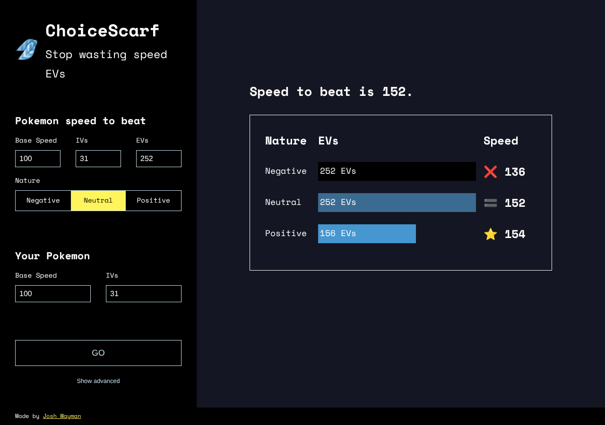

# ChoiceScarf

> **This is the `v5` branch**, a TypeScript rewrite in progress ([roadmap #59](https://github.com/joshwayman/choicescarf/issues/59)). The rest of this README describes v4, which lives on `main` and runs choicescarf.com; its source is not on this branch. For the v5 layout and commands, see [AGENTS.md](AGENTS.md). This README is rewritten when v5 launches (#89).

**Stop wasting Speed EVs.** ChoiceScarf works out the *minimum* Speed EVs your Pokémon needs to outspeed a target, for each nature, and tells you when only a Choice Scarf will do.

**Live at [choicescarf.com](https://choicescarf.com)**



## How it works

1. Enter the **Pokémon to beat**: base Speed, IVs, EVs, nature, and (under *Show advanced*) level, stat boosts, Choice Scarf, Tailwind and weather.
2. Enter **your Pokémon**: base Speed, IVs and the same advanced options.
3. Press **Go**. For each nature, ChoiceScarf finds the fewest EVs that make you strictly faster. A tie counts as a loss. If no nature can outspeed, it tries again with a Choice Scarf.

Speed is calculated the way the games do it (Gen 3+ stats, Gen 5+ battle modifiers), flooring at each step:

```
stat  = floor((floor((2 × Base + IV + floor(EV / 4)) × Level / 100) + 5) × Nature)
speed = floor(stat × boost stage)
speed = Scarf (×1.5), Tailwind (×2) and weather abilities (×2), chained into one
        4096-based modifier and rounded half down
```

The maths lives in [`src/lib/speedCalc.js`](src/lib/speedCalc.js) and is covered by [`src/lib/speedCalc.test.js`](src/lib/speedCalc.test.js).

## Development

Requires **Node 22** (see [`.nvmrc`](.nvmrc)).

```bash
nvm use
npm ci
npm run dev        # http://localhost:3000
```

| Command | What it does |
|---|---|
| `npm run dev` | Start the dev server |
| `npm test` | Run the tests once (Vitest) |
| `npm run test:watch` | Run the tests in watch mode |
| `npm run lint` | ESLint, zero warnings allowed |
| `npm run build` | Production build into `dist/` |
| `npm run preview` | Serve the production build locally |

### Stack

- [React 19](https://react.dev), built with [Vite](https://vite.dev)
- [Vitest](https://vitest.dev) + [Testing Library](https://testing-library.com) for tests
- ESLint 9 with the React, React Hooks and jsx-a11y plugins

### Project layout

```
src/
  lib/speedCalc.js        Speed maths (the important bit)
  lib/validation.js       Input ranges and clamping
  context/                State for both Pokémon and the results
  components/form/        The two input forms
  components/results/     Results chart and count-up animation
  hooks/                  useCountUp, useStickyState
index.html                Vite entry; also loads Google Tag Manager
```

## Deployment

- **GitHub Actions** runs lint, tests and a production build on every pull request and on pushes to `main`.
- **Vercel** deploys `main` to [choicescarf.com](https://choicescarf.com) and builds a preview for every pull request. Build settings are in [`vercel.json`](vercel.json).
- **Dependabot** opens dependency update PRs every Monday. Minor and patch updates are grouped into one PR.

## Contributing

All changes go through a pull request into `main`. See [CONTRIBUTING.md](CONTRIBUTING.md) for the workflow and labels. Coding agents should read [AGENTS.md](AGENTS.md).

## Credits

Made by [Josh Wayman](https://joshwayman.com). Pokémon and its terms are trademarks of Nintendo, Game Freak and The Pokémon Company; ChoiceScarf is an unofficial fan tool.
